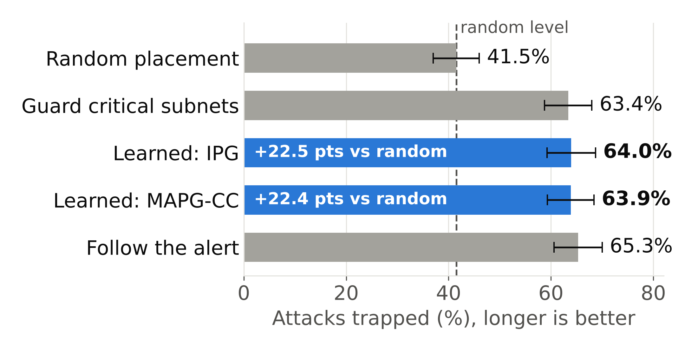
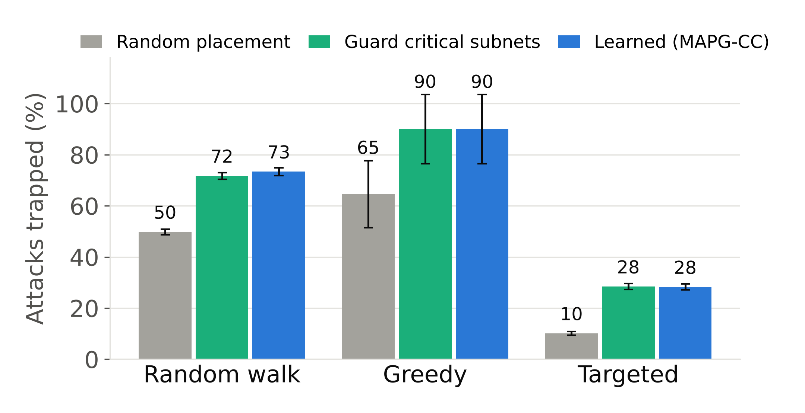

# MARLA Honeypot

**Multi-Agent Reinforced Learning Adaptive Honeypot**

[](https://github.com/Bebekuu/MARLA-Honeypot/actions/workflows/tests.yml)
[](LICENSE)


Code for the master's thesis *Adaptive Honeypot Placement Using Multi-Agent Reinforcement Learning* by **Bek**, Akita University.

A defender can afford only a few honeypots, and where they sit decides what they catch.
This repository contains a small network simulator in which several honeypot agents learn,
from a shared team reward, where to place and when to move their honeypots so that attackers
are trapped before they reach critical assets.

> **Status:** preliminary pilot (tabular agents, 20-host network, scripted attackers).
> The full thesis will move to neural MAPPO/IPPO agents, larger networks and adaptive attackers.

---

## Key results (pilot)

Mean over 20 random networks; 1,800 test episodes per method per network; 95% confidence intervals.

| Method | Attacks trapped (%) | Critical assets breached (%) |
| --- | --- | --- |
| Random placement | 41.5 ± 4.5 | 58.5 |
| Guard critical subnets (expert rule) | 63.4 ± 4.6 | 36.6 |
| **Learned: IPG** (independent agents) | **64.0 ± 4.7** | 36.0 |
| **Learned: MAPG-CC** (centralised critic) | **63.9 ± 4.6** | 36.1 |
| Follow the alert (hand-written rule) | 65.3 ± 4.7 | 34.7 |

- Learned agents beat random placement on **all 20 networks** (+22.5 points on average)
  without being told where the critical assets are.
- Against fixed attackers, they match the expert rule. Testing attackers that adapt is the next step.
- Targeted attackers (shortest path to the critical zone) escape most often: only about 28% are trapped by any method.




---

## How the simulation works

| Part | Pilot setting |
| --- | --- |
| Network | 20 hosts in 5 subnets: DMZ, Office A, Office B, Servers, Critical zone (2 critical assets). Every path to the critical zone passes through the servers. |
| Hosts | Vulnerability score drawn from 0.30–0.85 (chance an exploit succeeds). |
| Honeypots | 2 decoys, one agent each. Every step an agent keeps its honeypot or moves it to another subnet. A honeypot looks moderately vulnerable (0.75). |
| Observations | Noisy monitor alert of the attacker's subnet (10% missed, 5% false alarms) and the agent's own honeypot position. |
| Reward (shared) | +1 when the attacker is trapped, −1 when a critical asset is breached, −0.01 per honeypot move. |
| Attackers | Random walk; greedy (most vulnerable host in reach); targeted (shortest path to the critical zone). Up to 30 steps per episode. |
| Learners | Tabular softmax policy gradient (REINFORCE). **IPG**: each agent uses its own running-average baseline. **MAPG-CC**: a centralised critic that sees the attacker's true position during training only (the idea behind MAPPO). |
| Baselines | Random placement; guard the critical and server subnets (Hawkeyes' "critical" baseline); follow the alert. |

---

## Quick start

```bash
git clone https://github.com/Bebekuu/MARLA-Honeypot.git
cd MARLA-Honeypot
python -m venv .venv && source .venv/bin/activate   # Windows: .venv\Scripts\activate
pip install -e ".[dev]"
pytest -q
```

## Reproduce the results

```bash
# 1. Train and evaluate on 20 random networks (about 25 s per network on a laptop CPU)
python scripts/run_experiment.py --seeds 20 --workers 2 --out results

# 2. Print the summary table (also saved to results/summary.json)
python scripts/summarize.py --results results

# 3. Redraw the figures
python scripts/make_figures.py --results results --out figures
```

To run a single network and print its raw results as JSON:

```bash
python src/marla_honeypot/pilot.py 0
```

The committed `results/` folder holds the 20 seed files used on the poster, so step 3 works without re-running step 1.

---

## Repository structure

```
MARLA-Honeypot/
├── src/marla_honeypot/
│   ├── __init__.py
│   └── pilot.py              # simulator, attackers, baselines and learning agents
├── scripts/
│   ├── run_experiment.py     # train + evaluate over many random networks
│   ├── summarize.py          # tables with 95% confidence intervals
│   └── make_figures.py       # poster figures
├── tests/test_pilot.py       # quick unit tests (pytest)
├── results/                  # per-network results (seed0.json … seed19.json) + summary.json
├── figures/                  # generated figures
├── .github/workflows/tests.yml
├── pyproject.toml
├── requirements.txt
├── CITATION.cff
└── LICENSE
```

---

## Roadmap

- [x] Pilot simulator with scripted attackers and tabular multi-agent learners
- [ ] Neural MAPPO and IPPO agents (PyTorch) on 50–100 host networks
- [ ] Adaptive attackers that probe for honeypots or learn where they sit (hypothesis H2)
- [ ] Richer observations (alert history, graph features) and a penalty for duplicate placements
- [ ] Transfer to unseen network layouts

## Key references

1. Do Hoang H. et al. (2026). Hawkeyes: an intelligent honeypot allocation strategy for cyber deception using reinforcement learning. *Computer Networks* 276, 111982.
2. Park, Dagher (2026). Adaptive honeypot allocation in multi-attacker networks via Bayesian Stackelberg games. *Computers & Security* 168, 104949.
3. Javadpour A. et al. (2024). A comprehensive survey on cyber deception techniques to improve honeypot performance. *Computers & Security* 140, 103792.
4. Yu C. et al. (2022). The surprising effectiveness of PPO in cooperative multi-agent games. *NeurIPS 2022*.
5. Rigoni D. et al. (2025). Collaborative reinforcement learning for cyber defense: analysis of strategies, and policies. *SPAIML'25*, CEUR-WS Vol-4154.

## Citation

If you use this code, please cite it using the metadata in [`CITATION.cff`](CITATION.cff)
(GitHub shows a "Cite this repository" button).

## License

Released under the [MIT License](LICENSE).

## Acknowledgements

I thank Akita University for its support.
